<picture>
  <source media="(prefers-color-scheme: dark)" srcset="assets/hero-dark.svg">
  
</picture>

  <a href="https://jihoo12.github.io/"><b>website</b></a>
  &nbsp;·&nbsp;
  <a href="https://github.com/jihoo12?tab=repositories"><b>repositories</b></a>
  &nbsp;·&nbsp;
  <a href="https://github.com/jihoo12?tab=stars"><b>stars</b></a>

I like the layers most people never look at: boot code, schedulers, type checkers,
assemblers, compositors. Most of what I build starts as *"how does this actually work?"*
and ends as a small, from-scratch implementation, usually in Rust.

 

<!-- work:start -->
<a href="https://github.com/jihoolang/jihoo"><picture><source media="(prefers-color-scheme: dark)" srcset="assets/work-jihoo-dark.svg"></picture></a>
<a href="https://github.com/gloaming-dusk/shady"><picture><source media="(prefers-color-scheme: dark)" srcset="assets/work-shady-dark.svg"></picture></a>
<a href="https://github.com/jihoo12/kamo2"><picture><source media="(prefers-color-scheme: dark)" srcset="assets/work-kamo2-dark.svg"></picture></a>
<a href="https://github.com/jihoo12/faust"><picture><source media="(prefers-color-scheme: dark)" srcset="assets/work-faust-dark.svg"></picture></a>
<!-- work:end -->

 

<picture>
  <source media="(prefers-color-scheme: dark)" srcset="assets/signal-dark.svg">
  
</picture>

<picture>
  <source media="(prefers-color-scheme: dark)" srcset="assets/footer-dark.svg">
  
</picture>

Every image here is redrawn daily from live GitHub data by
<a href="scripts/generate.py"><code>scripts/generate.py</code></a>, no dependencies, no third-party services.

 

<h2 align="center">🐒 Monkey Civilization</h2>

  

 
  
