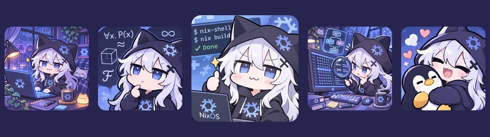
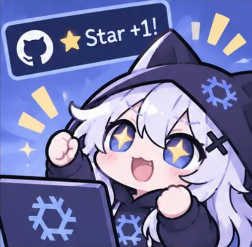

  

  

 

<h1 align="center">
  <a href="https://jihoo12.github.io/">website</a>
  &nbsp;·&nbsp;
  <a href="https://jihoo12.github.io/projects/">projects</a>
  &nbsp;·&nbsp;
  <a href="https://jihoo12.github.io/blog/">journal</a>
</h1>

  

<h2 align="center">🌌 A Year in Commits</h2>

  

 

   
  

 

Illustrations: Nixchan · Animated SVGs: <a href="https://github.com/jihoo12/github-readme-svg">github-readme-svg</a>, <a href="https://github.com/jihoo12/github-status">github-status</a> & <a href="https://github.com/jihoo12/monkeys">monkeys</a>

