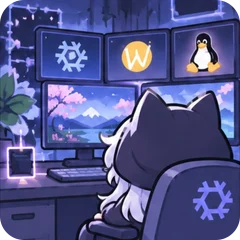

  

  

 

  <a href="https://jihoo12.github.io/"><b>website</b></a>
  &nbsp;·&nbsp;
  <a href="https://jihoo12.github.io/projects/"><b>projects</b></a>
  &nbsp;·&nbsp;
  <a href="https://jihoo12.github.io/blog/"><b>journal</b></a>

 

<table>
  <tr>
    <td width="50%" valign="top">
      
      <b><a href="https://github.com/jihoolang/jihoo">jihoo</a></b> 
      A systems language as fast as C, memory-safe without lifetimes or a garbage collector.
    </td>
    <td width="50%" valign="top">
      
      <b><a href="https://github.com/jihoo12/kaguyaos">kaguyaOS</a></b> 
      A hobby operating system for x86_64 UEFI, written in Rust.
    </td>
  </tr>
  <tr>
    <td width="50%" valign="top">
      
      <b><a href="https://github.com/jihoo12/Horn">Horn</a></b> 
      A small checker for very large proofs, with a 759-line trusted kernel.
    </td>
    <td width="50%" valign="top">
      
      <b><a href="https://github.com/gloaming-dusk/shady">Shady</a></b> 
      An experimental 3D Wayland compositor and Linux desktop.
    </td>
  </tr>
  <tr>
    <td colspan="2" valign="top">
      
      <b><a href="https://github.com/jihoo12/rosemary">Rosemary</a></b> 
      A dependency-free x86-64 reverse-engineering tool: decoding, typed IR, control-flow analysis and C generation.
    </td>
  </tr>
</table>

 

<h2 align="center">🌌 A Year in Commits</h2>

  

 

<h2 align="center">🐒 Monkey Civilization</h2>

  

Illustrations: Nixchan · Animated SVGs: <a href="https://github.com/jihoo12/github-readme-svg">github-readme-svg</a>

